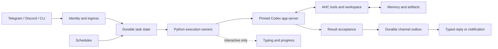

# Agent Harness Core

Agent Harness Core (AHC) is a self-hosted Python agent runtime for Linux that connects Telegram, Discord and a local CLI to an AHC-managed Codex app-server backend. It owns conversation identity, tasks, Python workspaces, tools, memory and delivery independently of the model's threads.

**Status: pre-release.** The active product lives in [python/](python/). Linux is the runtime platform; WSL is a supported deployment shape. The Rust crates remain a distinct historical implementation. Source tests, installed packages and live deployments are separate claims.

[Product Guide](docs/python-standalone/PRODUCT-GUIDE.md) · [Technical Overview](docs/python-standalone/TECHNICAL-OVERVIEW.md) · [Channel Notifications](docs/python-standalone/CHANNEL-NOTIFICATIONS.md) · [Backend Upgrades](docs/python-standalone/BACKEND-UPGRADES.md) · [Changelog](CHANGELOG.md)

## What AHC Provides

| Capability | Behavior |
| --- | --- |
| Conversations | Telegram, Discord and CLI entry points with exact agent, account, channel, user and virtual-session boundaries. |
| Continuity | Durable tasks, results and workspace checkpoints. A fresh backend thread does not create a new AHC conversation. |
| Interactive work | Optional typing and bounded public progress; final replies headed “💬 回覆” and progress headed “⏳ 互動進度”. |
| Scheduled work | Interval/daily schedules publish final “⏰ 定時任務” results without typing, Working timers or intermediate chat messages. |
| Tools | Persistent Python/IPython workspaces, artifacts, admitted child work and optional MCP integrations under the current policy. |
| Memory | Durable source records with scoped recall and a MemPalace/Qdrant semantic integration. Full-corpus acceptance remains explicit. |
| Skills | Versioned selection, qualification and protected reversible learning trials. Trial success does not imply useful adoption. |
| Delivery | Route-bound durable results with sent/unknown receipts. Uncertain effects and sends are not blindly repeated. |

## Latest Source Update

The Codex transport accepts incoming frames up to 16 MiB, with a 32 MiB queue ceiling and reader backpressure. Outgoing frames remain capped at 1 MiB; MCP incoming frames retain their separate 512 KiB bound. Rejected frames preserve payload-free failure details, unknown-effect custody and existing delivery receipts. Controlled real-pipe tests cover a large tool event, parent completion, notification and the next turn.

## How It Works



AHC owns task and effect boundaries; Codex supplies the admitted agent loop behind AgentBackend. A response can explain an unresolved task without accepting it as successful. The [technical overview](docs/python-standalone/TECHNICAL-OVERVIEW.md) describes ownership and recovery.

## Getting Started

Use Linux with Python 3.14 or later and [uv](https://docs.astral.sh/uv/):

```bash
cd python
uv sync --extra linux
uv run ahc --help
uv run pytest tests/test_channel_background_presentation.py tests/test_codex_app_server_contract.py
```

Launch requires an explicit configuration, a verified AHC-owned backend bundle, configured channel credentials and a workspace policy. Package installation does not create a bot, import another agent's credentials or start a service. Follow [native Linux configuration](docs/python-standalone/LINUX-NATIVE-CONFIGURATION.md) and [backend upgrades](docs/python-standalone/BACKEND-UPGRADES.md).

## Documentation

| Document | Purpose |
| --- | --- |
| [Product Guide](docs/python-standalone/PRODUCT-GUIDE.md) | User workflows, completion scopes and current limitations. |
| [Technical Overview](docs/python-standalone/TECHNICAL-OVERVIEW.md) | Runtime components, state, tools, backend and evidence boundaries. |
| [Channel Notifications](docs/python-standalone/CHANNEL-NOTIFICATIONS.md) | Interactive progress and background summaries. |
| [Backend Upgrades](docs/python-standalone/BACKEND-UPGRADES.md) | Linux pin, upstream provenance and qualification. |
| [Task Lifecycles](docs/python-standalone/TASK-LIFECYCLES.md) | Conversation, workspace, schedule, delivery and recovery behavior. |
| [Message Context](docs/python-standalone/CHANNEL-MESSAGE-CONTEXT.md) | Quotes, forwards, attachments and operation-bound context. |
| [Architecture](docs/python-standalone/PRODUCT-ARCHITECTURE.md) | Runtime ownership and supported platform boundaries. |
| [Transport and Rust Topology Contracts](docs/agent-harness-topology-contract.md) | Current Python transport bounds and the retained Rust topology. |
| [Security Policy](SECURITY.md) | Reporting and operational boundaries. |

Dated acceptance documents in the retained Rust documentation describe their named candidate and scope. They do not establish Python deployment acceptance.

## Source Verification

The last full Linux suite run (2026-10-30, before the latest transport repair) reported 4,127 passed, 155 failed and 150 skipped. Fresh checks of the updated transport, failure custody, notifications and backend contracts pass 168 tests. This update remains a source preview. See [source verification](docs/python-standalone/SOURCE-VERIFICATION.md) for environment, scope and remaining gaps.

## Current Limits

Channel-controlled trusted runtimes run scheduled work through a separate background owner, with dedicated schedule sessions and workspaces in the same store. Foreground conversation work can continue while a schedule runs. Configurations without that composition retain foreground idle admission. Ordinary user messages remain separate conversation requests.

Authenticated model execution, live selection, platform rendering, cold boot, endurance and full-product acceptance require evidence for the exact selected instance. Native child discovery does not prove all upstream delegation paths are admitted.

## License

Dual licensed under [MIT](LICENSE-MIT) or [Apache-2.0](LICENSE-APACHE).
