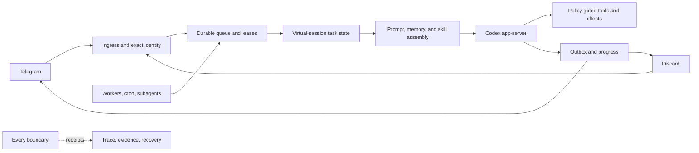

# Agent Harness Core Capability Map

Date: 2026-07-21

Status: pre-release source overview. This page describes public repository contracts and separates implemented foundations from design directions and evidence still required for broader claims.

## What Agent Harness Core Is

Agent Harness Core is a self-hosted, Windows-first Rust runtime that connects Telegram and Discord to Codex-backed agents through exact identity gates, durable queues, bounded workers, auditable receipts, and recoverable delivery. It provides the operational boundary around an agent: ingress, authorization, task continuity, prompt assembly, scheduling, external-effect control, observation, and final delivery.

The backend remains responsible for model reasoning, native tools, sandbox behavior, and its own concrete sessions. The harness adds durable authority and evidence without trying to become a second model runtime.

## How To Read This Page

| Label | Meaning |
|---|---|
| **Implemented foundation** | The source repository contains the mechanism and public contract. Appropriate tests or replay evidence are still required for each release. |
| **Evidence boundary** | A capability exists in source, but a stronger scenario, provider-visible, operating-system, or long-horizon claim needs additional evidence. |
| **Design direction** | Product architecture is documented, but the complete behavior is not claimed implemented or active. |

Passing a unit test does not prove a provider-visible behavior. Passive health does not prove a real Telegram or Discord presentation. A design note does not prove source wiring. Claims are kept at the evidence level that actually supports them.

## Major Product Direction: Adaptive Skill Intelligence

Agent Harness Core is extending skills from matched runbooks into an **evidence-governed procedural learning system**. The goal is to combine external knowledge with verified task experience, reflect on what worked under which conditions, and accumulate a reusable individual capability asset that can improve later comparable tasks.

The design is role-first and cost-aware: resolve the competence a task actually needs, enforce exact identity and capability boundaries, disclose the smallest useful procedure, join use with effects and outcomes, update contextual beliefs with uncertainty, and promote changes only through independent evaluation and exact rollback.

Current source already provides important foundations: scoped skill discovery and eligibility, selection and shadow receipts, proposal-mediated mutation, guarded apply, reversible lifecycle tooling, and virtual-session evidence contracts. Outcome-linked attribution, contextual beliefs, relationship-first consolidation, cost-aware evaluator routing, and progressively autonomous promotion remain design and implementation work.

Read [Adaptive Skill Intelligence](adaptive-skill-intelligence.md) or open the [web article](adaptive-skill-intelligence.html).

## Capability Map

| Capability family | Public source contract | Evidence boundary or direction |
|---|---|---|
| Durable channel ingress | Telegram and Discord inputs pass allow-list and exact platform/account/channel identity resolution before durable queue admission. | Every deployed account and channel still needs its own controlled provider-visible smoke evidence. |
| Bounded runtime work | Queue leases, retry/backoff, stale recovery, admission controls, and global/agent/channel/lane concurrency bounds isolate interactive and background work. | Crash-window, overload, fairness, and long-duration behavior require joined replay and controlled soak evidence. |
| Codex backend boundary | App-server plans, preflight, execution, terminal status, session continuity, and provider-scoped homes are explicit and receipted. | Backend upgrades require protocol fixtures and provenance checks; provider-specific behavior cannot be inferred from another route. |
| Virtual-session continuity | A stable virtual session owns task continuity while concrete backend sessions may compact, resume, or roll over with a bounded working set. | End-to-end claims require rollover and restart scenarios through final delivery; a new task remains a clean continuity boundary. |
| Channel experience | Normal replies, bounded progress, commands, media/attachment delivery, and guarded connector-approval actions share identity and delivery contracts. | Provider rendering, interaction expiry, duplicate callbacks, and long-message behavior need channel-specific replay or live evidence. |
| Workers, scheduling, and delegation | Durable worker jobs, cron evaluation, watchdogs, subagent ownership, bounded mailboxes, and master-only final synthesis are explicit runtime surfaces. | Scheduled-task persistence, reboot recovery, real worker effects, and heterogeneous provider behavior require higher-level evidence. |
| Memory adapters | Recall, lifecycle capture, proposals, approved writeback, imported snapshots, and per-agent compartments are adapter-owned and receipt-backed. | A fallback adapter is not full graph-memory parity; source coverage and cross-agent privacy must be proven for the configured owner. |
| Skill runtime foundations | Skills are scoped, indexed, revisioned, selected with receipts, guarded before controlled mutation, and managed through reversible lifecycle and pack operations. | The adaptive learning direction adds minimal disclosure, outcome attribution, contextual beliefs, topology evolution, and progressive promotion. |
| Dynamic task planning | Codex can own in-turn decomposition; optional durable OperationPlan state can own cross-turn milestones, dependencies, evidence, and recovery. Harness runtime authority owns budgets, effects, continuation, fairness, and final delivery. | Durable plan scope, continuation truth, token accounting, replanning, and provider-final behavior must pass joined virtual-session scenarios before activation. |
| Audit and recovery | Append-only receipts, trace reconstruction, health/status surfaces, JSONL repair, backup, canary records, and rollback controls make runtime decisions inspectable. | A receipt proves the recorded boundary only; restore, rollback, and provider-visible recovery need explicit drills. |
| Security and migration | Fail-closed identity, bounded untrusted context, secret isolation, encrypted-vault primitives, public-hygiene checks, and dry-run imports define the migration and trust boundary. | Live credential migration, rotation, operating-system persistence, and network-backed advisory review remain operator-controlled evidence. |

## Architecture Boundary

The harness owns exact identity, durable state, authority, scheduling, external-effect admission, and delivery. Codex owns model reasoning and native execution semantics. Shared features such as skill selection or planning must negotiate one semantic owner so the system never performs double selection, double learning, double continuation, or double delivery.

## Verification Model

| Evidence level | What it can establish | What it cannot establish |
|---|---|---|
| Static contracts and deterministic fixtures | Schemas, configuration interpretation, identity derivation, compatibility, and pure decision tables. | Runtime wiring or recovery. |
| Focused module tests | Local state transitions, validation, matching, serialization, and error handling. | Producer/consumer agreement across a task. |
| Component integration | Immediate boundaries such as queue-to-runtime, prompt-to-backend, effect-to-receipt, or proposal-to-guard. | Whole-task restart, channel delivery, or long-horizon operation. |
| Joined scenario and replay | Exact identity, virtual session, queue, backend, effects, recovery, outbox, and terminal behavior across one representative task. | Real provider presentation, operating-system persistence, or long-duration stability. |
| Controlled live evidence | Provider-visible behavior, real credentials and routing, service persistence, resource use, and bounded soak observations for one reviewed cohort. | Unobserved task classes or broader populations. |

Cross-cutting changes to identity, routing, memory, skills, planning, continuation, effects, or final delivery normally require joined scenario evidence. Live activation requires explicit authority, a narrow cohort, a tested rollback, and provider-visible readback where presentation matters.

## Adaptive Skill Measurement

Adaptive skill intelligence is evaluated with hard safety gates plus a multi-dimensional scorecard:

- task outcome and verifier uplift against no-skill, current-policy, or prior-revision baselines;
- required-role coverage and calibrated no-skill abstention;
- irrelevant disclosure, repeated loads, latency, tools, and uplift per 1,000 skill tokens;
- evaluator expense, maintenance churn, and regret reduction per unit cost;
- wrong-procedure, conflict, correction, invalid-composition, and drift rates;
- attribution uncertainty, belief calibration, held-out regression, false promotion, and rollback;
- zero cross-identity exposure, unauthorized effect, policy bypass, secret leakage, or irreversible mutation.

Selection, view, update, create, merge, and archive counts remain diagnostic activity—not evidence that capability improved.

## Delivery Path

1. Correct unsafe or unattributed current learning and planning behavior without enabling new serving paths.
2. Compile exact task, capability, skill revision, topology, and virtual-manifest contracts.
3. Compare routing, disclosure, evidence, and evaluator policies in a side-effect-free shadow path.
4. Join real task effects and outcomes before generating governed content or topology proposals.
5. Pass frozen replay and downgrade scenarios before any serving promotion.
6. Activate one reversible low-risk cohort only with explicit authority and controlled provider-visible evidence.
7. Widen autonomy by provenance, effect risk, residency, topology blast radius, reversibility, and independently calibrated evidence.

## Public Documentation

- [README](../README.md) — project definition, quick start, architecture, and documentation index.
- [Adaptive Skill Intelligence](adaptive-skill-intelligence.md) — product rationale, architecture, learning loop, decision-science model, and status boundary.
- [Skill Ecosystem](skill-ecosystem.md) — current implemented discovery, selection, learning-gate, lifecycle, and compatibility behavior.
- [Topology Contract](agent-harness-topology-contract.md) — identity axes, component ownership, invariants, and scenario impact.
- [Configuration](configuration.md) — public configuration reference.
- [Trust Boundaries](trust-boundaries.md) — untrusted-input, secret, effect, and publication boundaries.
- [Schema Registry](schema-registry.md) and [Invariants](invariants.md) — receipt/state compatibility and behavioral contracts.

This capability map is public source documentation. Private deployment receipts, operator-only runbooks, real identifiers, and machine-specific evidence are intentionally excluded.
