# Task lifecycles and blocking constraints

Status: accepted product decision. Applies to every declared agent and to CLI,
Telegram and Discord. Complements [the workflow failure policy](WORKFLOW-FAILURE-POLICY.md).

The minimum product outcome is a useful terminal result for a normal task and a
working subsequent or continuation task. A running service, a progress message,
or a working `/status` command does not establish that outcome.

Delivery recovery reads historical outbox entries using recognized, parent-bound
notice formats and retains their original payload and acknowledgment state.
Changing presentation does not authorize rewriting or resending old notices.
Service readiness also requires a successful foreground cycle after startup,
so historical delivery reconciliation is exercised before deployment is accepted.

Every blocking constraint must appear at a lifecycle node below and in the
constraint register, with its exact protected effect, owner, practical reason,
failure treatment and discriminating scenario. An unmapped constraint is a
removal item, not an implicit product rule. A number, the word "bounded", or
"security" alone does not justify blocking useful work. Registering a number
without demonstrating its necessity does not satisfy this rule.

## Shared task spine

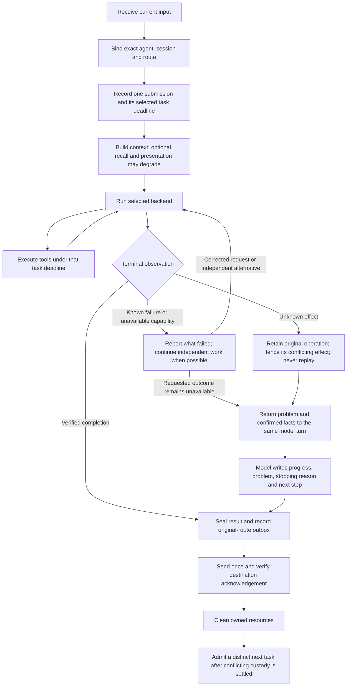

The conceptual `known failure` branch is capability feedback, not a new persisted
runtime-result disposition. Existing runtime result schemas remain authoritative.
An unverified tool effect still makes its containing task incomplete. A verified
model problem report is sealed and delivered, while the task remains unknown.
An exception is not itself evidence of an unverified effect. Determine what
could have happened at that phase before deciding whether it blocks the task.

## 1. Conversation and controls

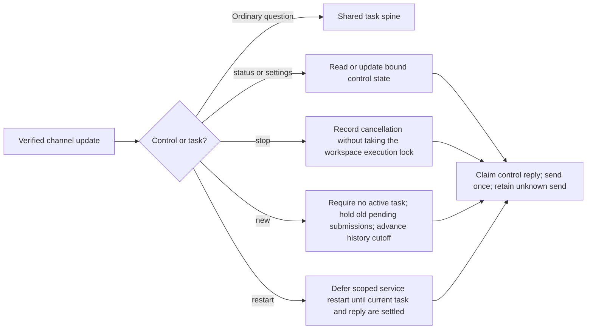

Controls use the independently running receiver. They do not wait behind model
execution. `/stop` retains context and requests cancellation; it cannot prove an
already started effect was rolled back. `/new` starts a new conversation history
without replaying old queued work. Local read-only command support and live
channel controls are separate entrypoints with explicitly different capabilities.

Source: `channel_control_store`, `foreground_control_pump`, `foreground_commands`.

## 2. Multistep task and continuation

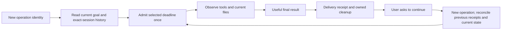

Continuation is a new task using previous evidence, not a resubmission of an old
operation or an automatic replay of uncertain cells. A new provider thread may
use AHC-owned conversation context and workspace state; provider-thread reuse is
not a prerequisite. A session reset and a service restart are different events.

Source: `runtime_conversation_context`, `runtime_service`, `foreground_runtime`.

## 3. Workspace, external tools and child tasks

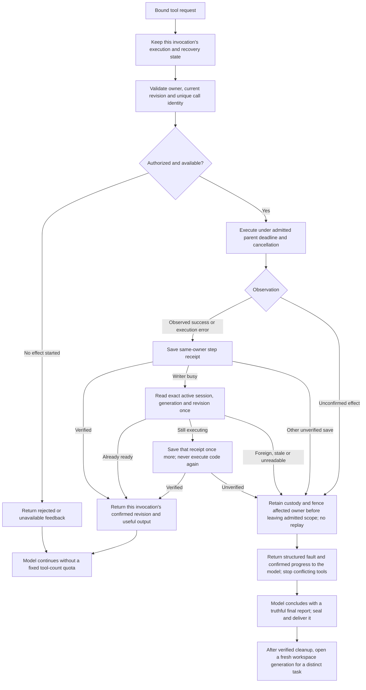

An admitted workspace cell shares its task deadline. `execution_timeout` remains
a startup/direct-call timeout for callers outside an admitted task; it is not an
extra short cell deadline inside that task. Scope always resets after backend
invocation. Cancellation is read without acquiring the workspace execution lock.
Admission failures before invoking the interpreter report `workspace-not-executed`
and keep a healthy workspace available. They cannot create an unresolved code
effect. The model may correct the cause and submit a distinct current-owner call.
An exact returned result followed by writer contention has one receipt-recovery
path: read back the active session, generation and revision; accept an already
ready head, or retry only that head's executing-to-ready compare-and-set once.
No interpreter call is repeated. A revoked owner, failed readback or exhausted
save attempt retains UNKNOWN and fences the affected workspace. The existing
repository wait and parent task deadline remain the time bounds.
Execution-started, failure and receipt-recovery observations belong to the
invocation. Synchronous tool projection reads the calling thread's observation;
a concurrently rejected admission cannot alter another invocation's state or
cleanup decision. A successful tool reply retains its own confirmed identity
even if a distinct call has already advanced the workspace. Possible-effect
failure fencing and cleanup occur before leaving the admitted execution scope.
Recheck the admitted deadline after any approval wait and before invoking the
tool. Expiry prevents a new invocation; it does not erase a trustworthy result
that an already invoked tool has returned. Preserve that observation and its
confirmed progress when settling a task that has run out of time.

Children have exact parent, session, workspace and result ownership. Their
effective execution deadline cannot exceed the parent's remaining time. Only
the parent synthesizes final channel output. Explicit owner-configured concurrency
and spend budgets are resource choices, not universal task-complexity quotas.
Unknown child work is not recreated using a different ID.

Provider-native collaboration follows its own correlated subflow:

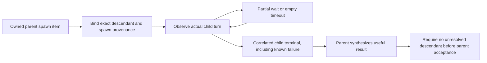

A wait response, child summary or token/status event is not child completion.
A known terminal child failure can inform the parent's alternative plan; it is
not automatically an unknown parent effect. Unbound or still active descendants
retain custody and cannot be silently ignored at parent settlement.
Native descendant registration, active call correlation, child turn-ID history
and prebinding notifications have no additional lifetime count or byte quotas.
The provider owns actual launches and its configured concurrency; AHC retains
exact correlation for this admitted conversation, under the parent's deadline.
Ordinary status advisories are consumed separately. Unbound effect-bearing events
still prevent parent acceptance, and correlation state is retired with the
conversation rather than trimmed to make an unresolved descendant disappear.

### 3c. Backend notification compatibility

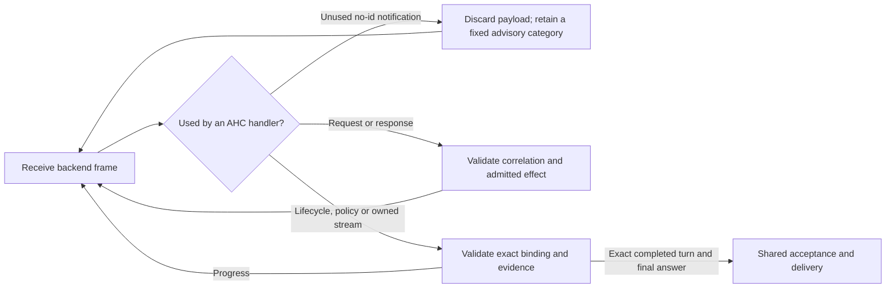

An unknown informational method is not a reason to abandon an admitted task.
Unused notifications, including error/retry observations, plans, diffs, tool
progress and future metadata, cannot execute code, change permissions, enroll
or settle a descendant, or establish completion. Discard their payloads before
native child handling; retain only an allowlisted advisory diagnostic. Server
requests with an RPC id never use this branch. Reserved actionable methods
missing their id, settings drift, foreign lifecycle events and incomplete final
evidence remain failures at their actual protected boundary. Only the exact
completed turn and full final answer can establish success.

Response collectors use the selected task deadline and cancellation, without
the former eight-pending/sixteen-frame count quotas. Notifications neither
extend that deadline nor cause a new model submission or tool replay. This
contract is shared by CLI, Telegram, Discord and every declared agent.

Source: `codex_status_notifications`, `codex_client_wire`, `codex_protocol`,
`codex_terminal_readback`. Regression: `test_codex_informational_notifications`.

Source: `codex_workspace_tools`, `wsl_python_workspace`, `runtime_workspace`,
`foreground_children`, `child_dispatch`, `runtime_mcp_tools`.

### 3b. Workspace checkpoint and restore

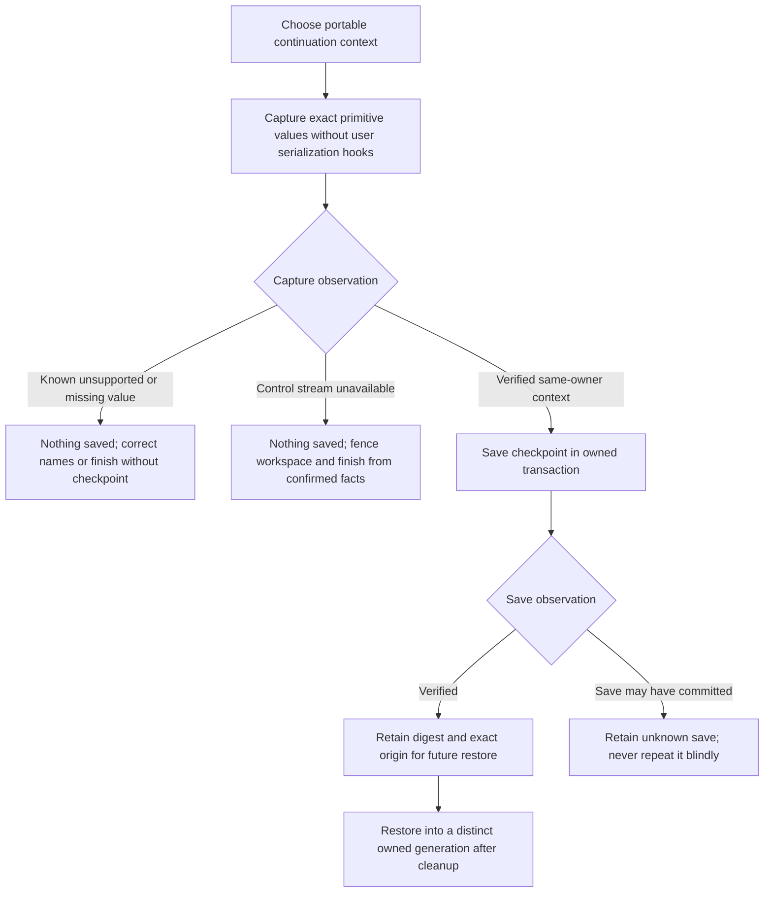

Capture and durable save are different phases. A missing name, opaque object,
container subclass or unsupported value is a known no-save rejection and leaves
the healthy kernel usable. The kernel snapshots only exact portable primitives,
so checkpoint serialization cannot invoke arbitrary user conversion hooks.
A lost or malformed capture stream closes/fences the workspace and cannot invent
a saved checkpoint; already confirmed facts may still support a useful text
answer. Failed cleanup retains that resource's exact custody and blocks conflicting
new workspace admission. Once the checkpoint writer is called, a lost save receipt
retains UNKNOWN. This does not turn a possible durable write into a value rejection.

### 3a. Artifact construction, publication and selection

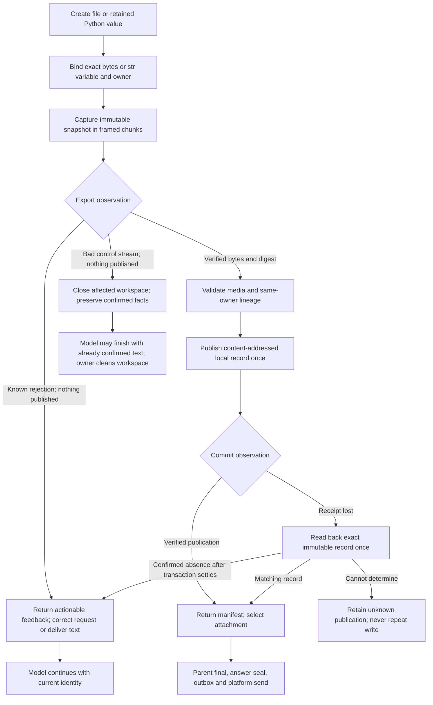

`artifact.name` selects a Python variable, not a pathname. Read an existing file
into a bytes variable in a short cell first. `lineage` contains existing artifact
IDs, not channel message IDs. Export snapshots use exact primitive types, without
calling object representation or conversion hooks. UTF-8 text is measured in
encoded bytes. Internal 32 KiB raw chunks fit the actual 64 KiB JSON control
frame, including base64 and envelope; the frame bounds each transfer, not total
artifact size. Each chunk uses the original export identity, exact offset, total
and digest. Malformed or lost control replies close that workspace, but cannot
mean an artifact was published before the publisher was called.

There is no extra 16 KiB export, 1 MiB artifact, sixteen-ancestor lineage,
eight-attachment selection or child text ceiling. Local storage/runtime capacity,
the admitted deadline, explicit parent allocation and actual destination limits
remain separate owners. Read pages preserve access past 1 MiB. Export currently
collects the verified content for SQLite BLOB publication; it is not a promise of
constant total memory use for arbitrary-sized files.

The publication phase is monotonic: before the first possible database write,
failure is known not-published. After a possible commit, only exact local readback
can establish publication or nonpublication. A nested child publication shares
its parent's allocation transaction; an inner callback cannot declare that outer
transaction committed. Child allocation exhaustion rejects before new writes
and permits a useful text result. Selection alone does not upload anything.

Source: `workspace_artifact_tools`, `runtime_workspace`, `workspace_kernel`,
`workspace_artifact_export`, `artifact_repository`, `child_artifacts`,
`runtime_result_artifacts`.

## 4. Scheduled work

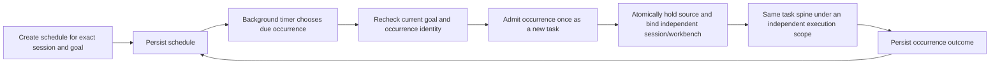

Channel-controlled trusted runtimes use one background owner, independently of
the foreground model loop. One workbench step runs per timer cycle with rotation
between schedules. The background model does not own the foreground active-turn
slot, so ordinary messages and `/new` remain available. `/stop` affects the
foreground; `/restart` pauses new background admission and waits for active work
and its delivery. Held or unknown occurrences do not authorize catch-up replay.
Already-submitted legacy foreground occurrences are not silently migrated.

Source: `background_schedule`, `background_schedule_dispatch`, `foreground_schedule`,
`schedule_tick`, `schedule_occurrences`.

Scheduled work is notification-only: it publishes a typed final result or reminder
without typing, a Working card, intermediate progress or a new approval conversation.
An approval-required effect remains unapproved. Ordinary user messages enter their
own foreground conversation even while a background model runs. The saved handoff
determines presentation after restart; a long interactive task remains interactive.
Distinct execution scopes retain the exclusive global backup/restore gate and the
existing full-user permissions. See
[channel notifications](CHANNEL-NOTIFICATIONS.md) for categories and compatibility.

## 5. Memory, skills and learning

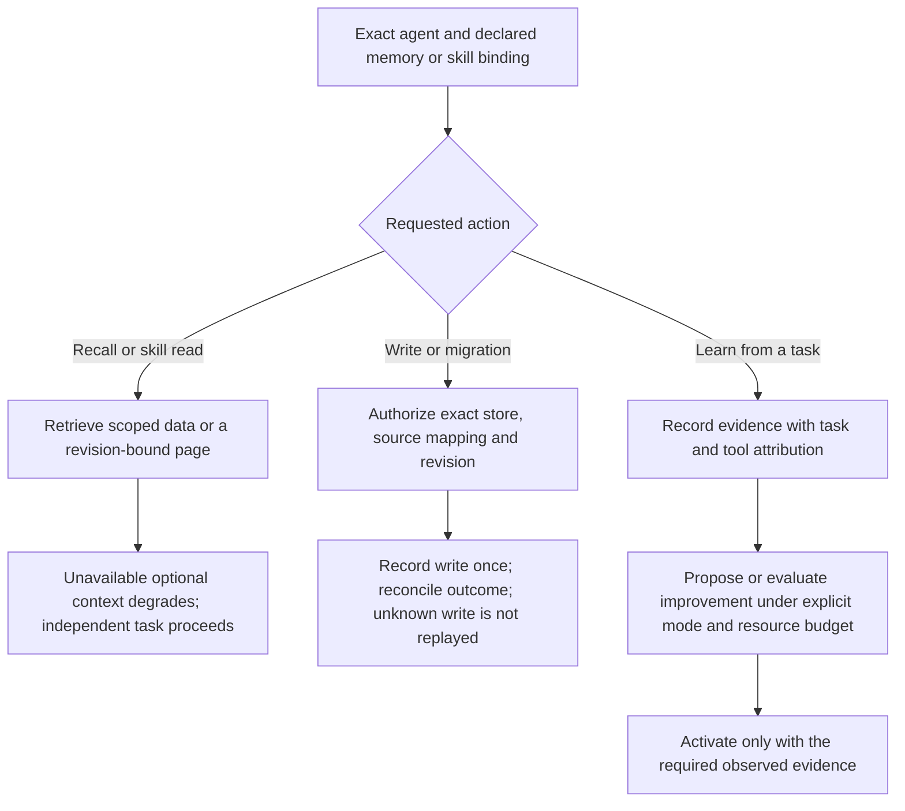

Missing recall is unknown availability, not proof of an empty store. Memory
source mappings preserve cross-agent isolation. Skill list/read pagination is a
delivery mechanism, not a cap on the total skill body. Experience capture failure
does not invalidate an otherwise confirmed task result. An incomplete task can
provide failure observations; it cannot prove successful skill improvement.

Source: `workspace_memory_pack`, `workspace_memory_search`, `workspace_skills`,
`foreground_learning`, `workspace_learning`.

## 6. Result and platform delivery

### Model-led problem reports

A dynamic-tool UNKNOWN, unexpected admitted-adapter exception, or explicitly
unavailable workspace switches that **turn** to final-report mode. The original
model continues under its original deadline and cancellation. Structured feedback
contains the fault, confirmed observations and an instruction to report completed
progress, the problem, why execution stopped, remaining uncertainty and the next
useful step. Further tool calls are rejected before approval or invocation: an
arbitrary cell may have touched multiple resources, so the bridge cannot safely
infer independence. This fence lasts only for that turn; it does not stop other
agents, independent controls or a distinct task after verified resource cleanup.

Only a correlated, nonempty model terminal response admits `report_accepted=true`.
The additive v2 result keeps `accepted=false`, `disposition=unknown` and the actual
`unresolved_effects` value. The parked task intent remains parked. The existing
answer seal binds the report to its original operation, session and thread/turn;
the outbox delivers its text once without the generic incomplete-task wrapper.
Reports cannot select attachments or reply targets. Prior verified artifacts stay
in confirmed-work recovery facts rather than becoming an uncertain new delivery.

Acknowledged reports enter exact-route conversation history with their unknown
task disposition and unresolved-effect flag. A report without acknowledgement is
not treated as delivered. A matching immutable seal is required even for local
conversation history. Model completion closes the response; it does not certify
goal completion or settle an unknown operation. Cleanup failure annotates the
sealed report and keeps resource custody independently.

Known execution errors and correctable no-effect rejections retain their ordinary
model/tool loop. A missing model transport, invalid owner/lifecycle frame, explicit
cancel or exhausted hard deadline may prevent a model report. Preserve the actual
fault and confirmed progress and use the grounded system fallback; never create
another model submission or replay the original tool solely to obtain a report.

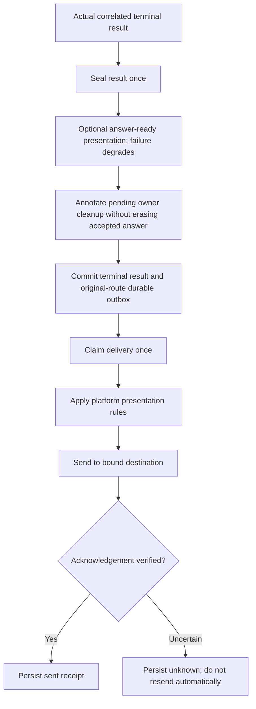

Platform limits belong at the channel adapter. The core and outbox retain the
full accepted text. Both adapters upload a complete UTF-8 document when text
exceeds the single-message range, under the original claimed delivery operation.
Discord and Telegram each require their own destination acknowledgement evidence.
An uncertain upload remains unknown and cannot be sent again automatically.
The outbox checks the exact terminal intent, original route and immutable answer
seal. Learning capture and Canvas observation run as optional finalization;
their failure cannot invalidate tool feedback, acceptance or an acknowledged send.
Owner cleanup may also run before terminal commit; a verified answer survives
failed cleanup with a pending annotation, while conflicting admission waits for
that owner's recovery. Artifact publication, attachment selection, parent
acceptance and platform acknowledgement are four different observations.

Source: `runtime_channel_store`, `channel_outbox`, `channel_delivery`,
`channel_text`, `channel_formatting`.

## 7. Cancellation, faults and service recovery

Exception handling uses two independent facts: the effect's observation and the
resource's health. Do not turn every exception into task-level UNKNOWN.

| Phase / example | Effect observation | Recovery and continuation |
|---|---|---|
| Request binding or primitive export rejection | No requested effect started; artifact not published | Return a known rejection and current request guidance. Correct the request or choose an independent alternative. |
| Workspace admission raises before interpreter invocation | No code effect started; durable admission may need current-state inspection | Return `workspace-not-executed` with a sanitized phase/category; leave the healthy interpreter available. A new call must pass exact current admission again. |
| Python cell returns an execution error | Execution returned; preceding writes in that cell may exist | Return the current revision and sanitized exception category. Inspect existing state, then correct the cause or choose an alternative; no blind replay. |
| Verified cell reply followed by a busy step-receipt writer | Code result known; step receipt not yet confirmed | Read the exact active head once. A ready head resolves the receipt; an executing head permits one same-owner receipt save. Never repeat code. Changed ownership or unresolved save fences only the affected workspace. |
| Execution or reply fails and cleanup also raises | Original effect observation and cleanup health are separate | Preserve the first phase/category and record cleanup as unverified. Cleanup cannot replace the original cause or release unresolved custody. |
| Export control stream is malformed or lost | No artifact publication; workspace health unverified | Close/fence that workspace, return not-published feedback, and permit an already supported text result. Cleanup owns future workspace admission. |
| Checkpoint value unsupported or capture stream lost | No checkpoint writer called | A known value rejection permits smaller primitive context or no checkpoint. A broken stream fences the workspace; confirmed facts may still support text completion. Possible save receipt loss remains UNKNOWN. |
| Local publication loses its acknowledgement | Commit may have happened | One exact immutable-record readback, no repeated write. Matching content resolves publication; settled absence resolves nonpublication; failed readback retains UNKNOWN. |
| Arbitrary execution or external effect cannot be observed | Unknown actual effect | Stop conflicting tools and retain the original operation; return the problem and confirmed facts to the still-running model. Seal its truthful final report separately from task acceptance; independent controls and other owned agents continue. |
| Typing, answer-ready, advisory metadata, learning capture or Canvas fails | No change to execution/acceptance/delivery authority | Degrade locally without another attempt. Continue the task using its actual observations. |
| Accepted answer has cleanup failure | Answer remains verified; resource cleanup pending | Deliver the accepted answer with its cleanup annotation; retain exact custody before conflicting work. |

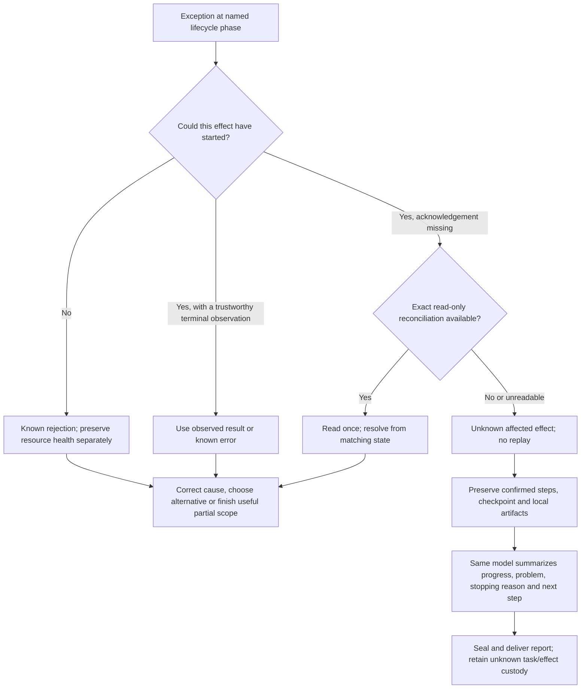

Confirmed recovery facts are optional metadata from this exact task's observed
tools, not model commentary or a completion claim. Failure notices distinguish
saved local artifacts from destination delivery and preserve the original
unknown result. Reopening a new workspace does not resolve that historical effect.
Workspace faults preserve fixed admission, send, receive, result-validation,
result-save or execution categories through tool feedback and durable backend
diagnostics. Original exception text, paths and user payload are excluded.
Malformed optional fault metadata is discarded without erasing the valid primary
diagnostic. Telegram and Discord use the same phase-specific failure projection.

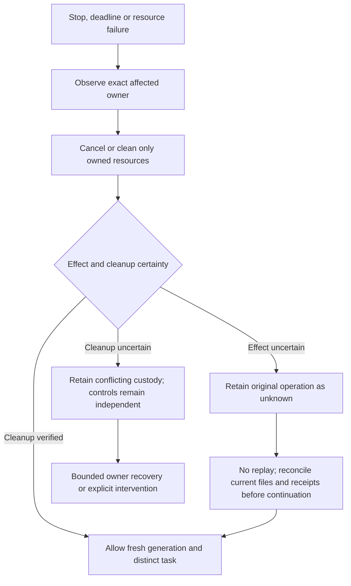

The native guest, service supervision and Windows client/interop have different
owners. Lost Windows interop does not stop native reception or execution. A
closed, successfully cleaned workbench can be replaced for a new task. A failed
replacement is not retried each pump tick. Historical unknown task results and
files remain unchanged; opening a new generation does not replay the old cell
or promise restoration of an uncheckpointed Python namespace.

Source: `foreground_runtime`, `backend_recovery`, `backend_custody`,
`native_process_runner`. Deployment selection separately requires the exact
installed process generation and rollback custody; it is not part of every user
task's hot path.

When code selection and receiver readiness have been acknowledged but releasing
the maintenance marker encounters a competing writer, recovery must wait only
within its declared writer-acquisition budget. After acquiring the transaction,
it rechecks the captured serving owner, installed selection and configuration,
then removes only its exact marker. It never repeats service stop/start. An
exhausted wait, changed identity or uncertain mutation retains custody for
reconciliation. Temporary contention is not evidence that useful task execution
requires another universal limit.

## Constraint register and removal disposition

Discord transport recovery is independent of task execution. A configured
connection count bounds a burst, followed by a60second cancellable cooldown;
ordinary reconnects wait5seconds. This prevents rapid repeated socket creation
without permanently disabling a standalone receiver after a transient outage.
Fatal authentication/configuration, failed session invalidation and unavailable
Identify quota admission retain their separate protected-effect pause. Resume
and durable input deduplication do not replay task execution.

Durable callback failure is a separate branch at READY, RESUMED, input dispatch
and invalid-session handling. The receiver pauses with a fixed checkpoint or
dispatch-persistence category and preserves its prior sequence; it cannot borrow
a newer writer's checkpoint. This protects input ownership and duplicate-task
prevention. Independently owned local work and interfaces remain available.

| Node / owner | Constraint and concrete purpose | Treatment / evidence |
|---|---|---|
| Bind / ingress and runtime | Exact `agentId`, platform/account/channel/user/session tuple, goal, generation and revision. Prevents applying another agent's authority, private data or result to this effect. | Keep at the effect. Foreign-route/session and stale-revision scenarios must reject before execution or delivery. |
| Admit / runtime repository | Durable operation/call/occurrence identity and consumed submission. Prevents repeating an effect after lost acknowledgement. | Keep. Duplicate and unknown replay scenarios inspect the retained original receipt. |
| Save step receipt / workspace runtime | Revalidate the active session, generation and revision before the executing-to-ready transition. Prevents treating a foreign or revoked owner's result as current. | Keep. After writer contention, one exact readback and at most one receipt CAS are permitted; code is never retried. Test real SQLite contention, committed acknowledgement loss, revocation, exhaustion, final delivery and a distinct next task. |
| Maintenance / deployment owner | A temporary exact-owner admission fence protects work from cancellation during code selection. The quiet check and fence share the runtime admission transaction; the stop request retains the originally captured process generation. | Keep only during selection/recovery. New messages remain queued, no notice is sent by the fence, and admission resumes after acknowledged receiver readiness. Rollback transfers the owned fence without an admission gap. An uncertain stop remains pending for reconciliation rather than being replayed. |
| Execute / task owner | Selected task deadline and cancellation. The user or configured task owner bounds how long work may occupy its resources. | Keep one admitted deadline; cells inherit it. Test slow cell, remaining-deadline expiry and cancellation during silence. |
| Execute / workspace | Extra configured 30-second cell timeout inside a 600-second admitted task. No distinct protected effect; prematurely destroys useful work. | Removed from admitted turns; retain startup/direct-call timeout separately. Test actual cell longer than 30 seconds and following cell/checkpoint/restore. |
| Execute / workspace bridge | Universal 16-call limit. No user spend policy or state-safety relation; rejected reads could consume it and end useful tasks. | Removed. Keep call count as telemetry, remaining task time and unique call ownership. Test more than 16 calls and final completion. |
| Tool feedback / workspace bridge | Extra 32 KiB serialized-result cap. Duplicates transport concerns and is especially sensitive to escaped Unicode. | Removed. Preserve the full valid result within the actual transport frame. Test Unicode result over the former bound with unchanged success and no replay. |
| Submit code / native kernel | Actual 64 KiB encoded control frame, including JSON envelope, escaping and newline. Prevents a request exceeding the framed transport's allocation. | Keep the actual frame check before reserving execution. Remove the separate 16 KiB code quota; encoded-frame rejection runs nothing and permits a smaller cell or loading a file. Test code above 16 KiB and escaped input that exceeds the wire despite a smaller raw size. |
| Execute / effect owner | Current execution grant, original provider/account and exact process/cgroup identity. Prevents unapproved launch, recipient substitution or killing a replacement owner. | Keep. Optional status and presentation are not authorization evidence. |
| Tool output / kernel | Captured stdout preview of 4,096 characters with an explicit truncation flag; skill/artifact read pages and portable checkpoint values. Keeps model context and interpreter control frames usable. | Preview/page limits must not destroy executed work. Full data remains in workspace variables/files or source pages; next-page/read locators and current identity must be usable. Checkpoint value rejection saves nothing and allows selecting portable context. |
| Export / kernel and artifact publisher | Exact immutable bytes/text, framed chunk identity/offset/digest, publication phase and same-owner lineage. Prevents converting arbitrary objects or attributing another value/owner to a publication. | Keep these effect checks. Remove former 16 KiB export, 1 MiB total and sixteen-lineage caps; verify the normal ZIP, Unicode, multi-chunk and above-1-MiB paths. Prepublication errors are not UNKNOWN writes; bad stream health is separate. |
| Select / parent and ordinary child artifacts | Distinct selected IDs, safe platform filename/caption and explicit parent allocation. Selection must refer to owned published content; it does not send. | Remove the universal eight-selection and child 16 KiB text/allocation maxima. Keep the owner's actual count/byte budget; exhaustion rejects before new publication. Verify nine selected attachments, foreign owner rejection and a known rejection followed by useful text. |
| Wire / stdio transport | Current 1 MiB outbound and 4 MiB inbound frame buffers, eight queued frames. Bounds simultaneous parser/queue allocation to about 32 MiB of queued raw data plus the current frame; queue backpressure preserves valid frames. | These protect simultaneous allocation, not total task work. Valid oversized tool feedback becomes an explicitly partial preview fitted against the actual encoded frame size, retaining its execution disposition, digest and no-replay instruction. No cumulative frame/event/byte quota. |
| Deliver / channel adapter | Platform message/file constraints and verified acknowledgement. Prevents requests the provider rejects and misattribution of a send. | Full accepted text is retained by the core and outbox. Text beyond the single-message range is delivered as one complete UTF-8 document under the same claimed operation and original route. An uncertain upload remains unknown and is never retried automatically. |
| Settle / result and custody owner | Correlated actual final, answer seal, unknown effect and exact cleanup. Prevents reporting success from a progress event or replaying uncertain work. | Keep at affected effect. Preserve useful accepted result when optional presentation/diagnostics fail. Workspace failure is identified as a tool failure, not malformed provider JSON. |
| Context / optional enhancements | Recall, warning payloads, typing/status/Canvas and experience capture. None establish execution or delivery authority. | Degrade locally. No optional enhancement may become an independent admission or completion gate. |
| Namespace / native execution boundary | Read-only and protected roots hide credentials and authoritative state while leaving the ordinary user's authorized files accessible. | Keep exact paths, nonempty/unique declarations and mount validation. Remove the arbitrary maximum of 16 roots; hide ancestor project configuration at every actual ancestor rather than stopping after 32. Test more than 16 protected roots without exposing authoritative state. |
| Workspace / RPC serialization | A single kernel requires serialized individual operations; shared tools must borrow the same admitted deadline. | Lock individual RPCs and short deadline updates. Do not hold the RPC lock while yielding across the whole model turn; that would block a child thread's authorized workspace operation. Test a child thread using the same workspace during an admitted turn. |
| Background schedule owner | One due admission and one workbench step per timer cycle; independent foreground session and workbench. | Keep scheduling fairness and foreground availability, without limiting a task's steps. |
| Owner budgets / children and learning | Explicit configured concurrent workers, trials and spend/time budgets. Their owner is protecting shared resources or an accepted experiment budget. | Keep declared owner budgets; undocumented numeric parser ceilings on those budgets are removal items, not additional owner choices. |
| Native descendants / provider conversation | Exact spawn provenance, unique turn and call IDs, owned receivers and terminal descendant observations. Prevents granting a child parent authority or accepting while child work is unresolved. | Keep correlation and settlement. Remove the extra 16-child, 32-call, 64-child-turn and 32-frame/128-KiB prebinding quotas; they can reject valid work without resolving any effect. Verify work past each old boundary, partial waits, foreign/duplicate events and unsettled parent rejection. Actual framed transport allocation and configured provider concurrency remain separate. |

Native call IDs remain consumed for their sender/turn across spawn and non-spawn
tools until conversation retirement. A wake request or active status can mark
descendant work unresolved, but cannot reactivate a consumed terminal. Only a
fresh unique child turn and its correlated terminal settle the newly active work.

The implementation removes the identified lifetime cumulative frame/event/byte
quotas, extra route/connection-count ceilings, protected-skill count ceiling,
daily-budget maximum, child-timeout maximum, and extra maxima on owner-selected
child count/concurrency/artifact budgets. The owner's declared budgets still apply
before dispatch; child deadlines cannot exceed their parent. Positive/type checks
keep these declared quantities meaningful, without inventing another quota.
Telegram polling requests a finite batch per HTTP request to keep receiver/control
work interleaved; this is not an inbox lifetime quota or route-count limit.

The parent-task cell timeout, 16-tool ceiling, inner 32 KiB feedback ceiling and
core 4,096-character final ceiling are removed. Startup/direct probes remain
finite; admitted cells inherit the parent deadline. A closed workspace may be
replaced only for a distinct new submission after owned cleanup, preserving the
old unknown operation and preventing replay. Historical failure diagnostics
identify workspace/tool uncertainty rather than calling it malformed provider JSON.

Source implementation, staged checks, actual provider scenarios and live selected
instances remain separate evidence. This document alone makes no deployment or
whole-product readiness claim.

New or retained checks must be mapped here, reviewed at their actual consequence,
and exercised with a normal user path. Unknown necessity does not authorize
retaining an undocumented fatal gate indefinitely. The remediation owner must
remove it or demonstrate a specific necessity and a workable large-data/failure
path. Repeated green component tests with failed real tasks reopen only the
affected lifecycle; they cannot qualify the complete product.
